<div align="center">

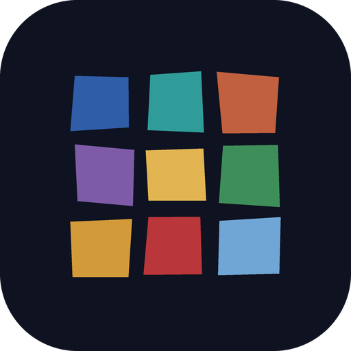

# Tessera

### The same questions, year after year.

*Ask your child, yourself or your grandmother the same questions every day, week, month or birthday, on film, by voice or in words. Every answer is laid as a stone of coloured glass. The years become a mosaic you can walk back through, and the chorus of years plays a face and a voice growing up. Free, no ads, no account, no cloud.*

[](https://github.com/bigdevwhale/tessera/actions/workflows/android.yml)
[](https://github.com/bigdevwhale/tessera/releases/latest)


[](LICENSE)

**English** · [Русский](README.ru.md) · [Changelog](CHANGELOG.md)

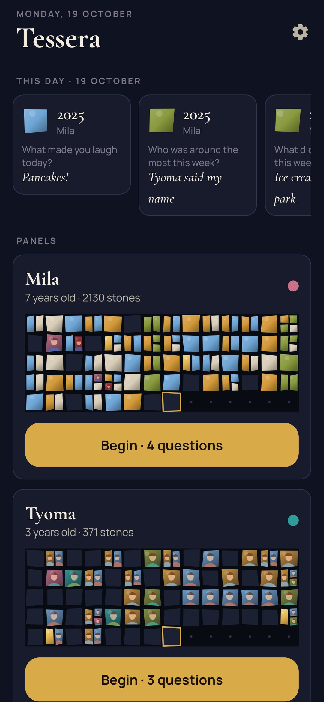 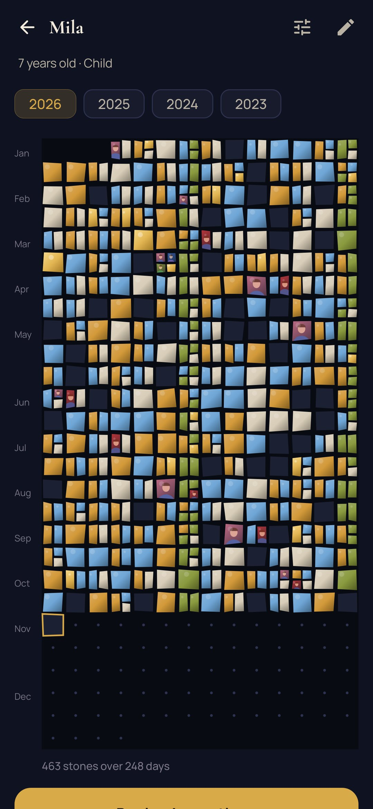 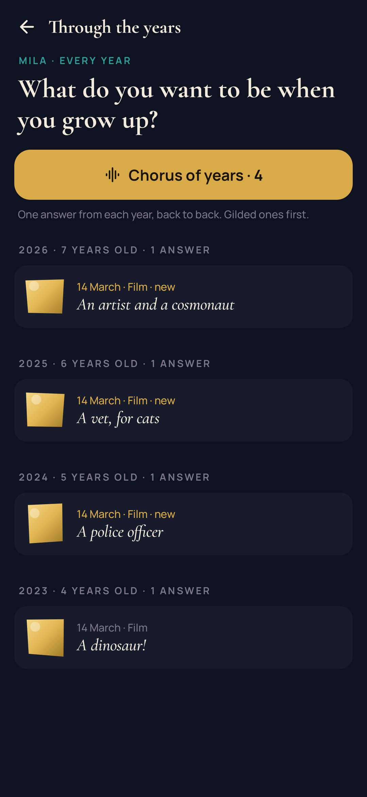 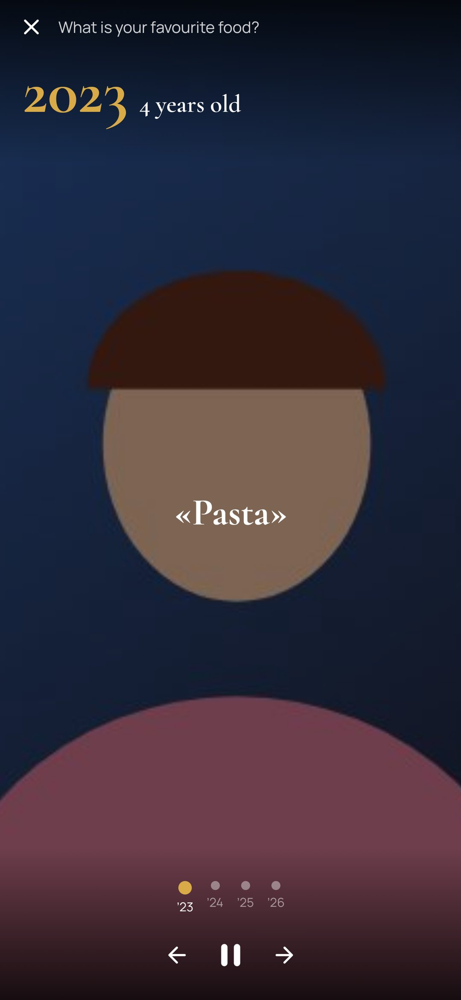

</div>

---

## The idea

Some families keep a birthday interview: the same ten questions every year, written in a notebook. *What do you want to be? Who is your best friend? What scares you?* Read ten years later, the answers turn into a portrait of someone growing up. Tessera does that on the phone, as often as you like. A tiny question every evening, a longer one each week or month, and the big interview on the birthday. Each answer becomes a smalt, a stone of glass, in that person's mosaic.

## How it works

1. **Add someone.** A child, yourself, a grandparent. They get a starting set of questions for their age, each with its own rhythm: *every day*, *every week*, *every month* or *every year* (on the birthday).
2. **Answer.** Each evening the questions that are due come up. A long daily list takes turns, a few a day, so it never becomes a chore. Answer on film, by voice or in a few words.
3. **Film it properly.** The camera is built in, so the question stays on screen while you speak. Last time's frame lies faintly over the picture so you sit the same way and the years line up. There's a 3-2-1 countdown, and a gold ring shows the time left: 15 seconds for a day, five minutes for a birthday.
4. **A year ago…** Right after you answer, the answer to the same question from a year ago comes back.

## Looking through the years

| | |
|---|---|
| 🧩 **The panel** | Each person's year is a mosaic of two-week rows, one stone per day, hand-cut and slightly uneven. A filmed answer shows its frame through the question's glass; a day with several answers splits into smaller stones. |
| 🎼 **The chorus of years** | One answer from each year to the same question, back to back: *a dinosaur → a police officer → a vet → an artist and a cosmonaut.* Films fill the screen, voices play, words stay up long enough to read. |
| ✨ **Gilded stones** | Mark the answers you want to keep above all. They turn to gold leaf in the panel and the chorus picks them first. |
| 🪨 **Unchanged since…** | An answer that has held for three years or more is marked: *Grandma's pancakes, unchanged since 2025.* |
| 🔤 **Words of the year** | What a year of daily answers kept coming back to: *bath · boats · sand · digger.* |
| 📅 **This day** | What was said on today's date in earlier years, at the top of the home screen. |
| 🎂 **The birthday interview** | On the birthday the year's questions wait as one sitting, with last year's frame in the camera. |

## Questions

There's a library of more than fifty questions in English and Russian, in five sets. You can add any of them, or write your own, and change how often each one is asked and how it is usually answered.

- **Little ones (3–6)**: everything is filmed, nothing to read or type.
- **Children** and **teenagers**: friends, fears, what to be, what changes.
- **Grown-ups**: what matters now, what this year taught you.
- **Elders**: the house they grew up in, how they fell in love, a song from their youth. Their voices, while there is time to ask.

## Privacy

There is no account, no cloud and no analytics. Films, voices and words stay in the app's own folder on the phone. *Settings → Backup* packs everything, media included, into one ZIP you keep wherever you like. The camera and microphone are used only while you record an answer. The only notification is one evening reminder, and only when a question is waiting.

## Screenshots

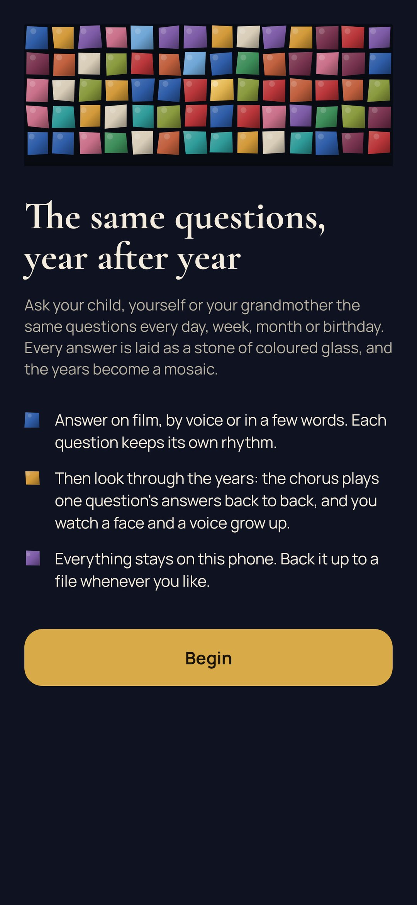 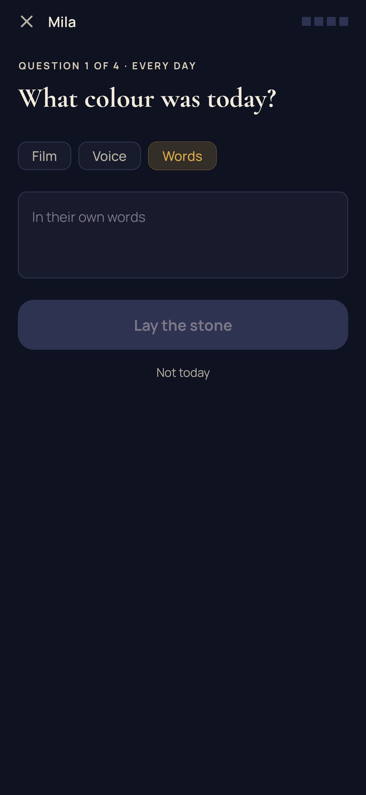 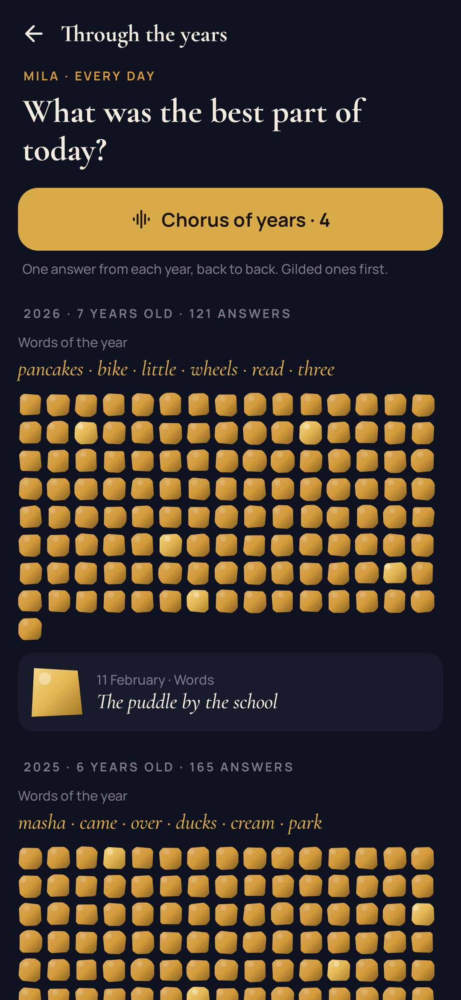 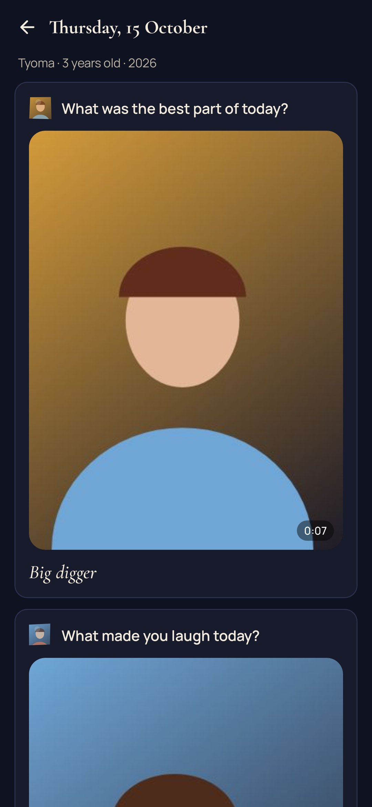 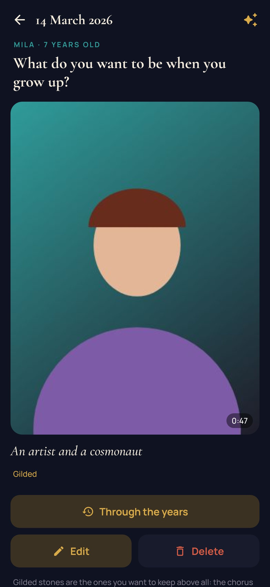 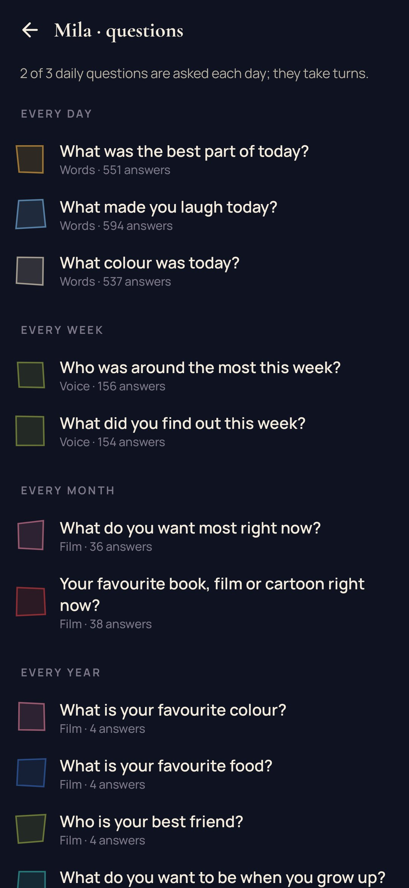

## Build

```bash
./gradlew assembleDebug             # app.tessera.dev
./gradlew assembleDebug -Pdemo      # app.tessera.demo: Mila, Tyoma and Grandma Vera with years of answers
./gradlew testDebugUnitTest         # unit tests
./gradlew testDebugUnitTest -Prender --tests '*RenderArtScreens*' && python tools/shots.py   # README screenshots
python tools/icon.py                # docs/logo.png from the launcher icon
```

Kotlin, Jetpack Compose, Room, DataStore, CameraX. Fonts: Cormorant and Manrope (OFL).

Part of [Stillcraft](https://bigdevwhale.github.io/stillcraft/). MIT licence.
