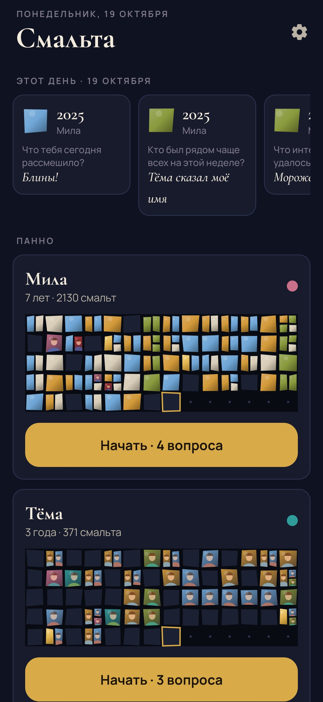
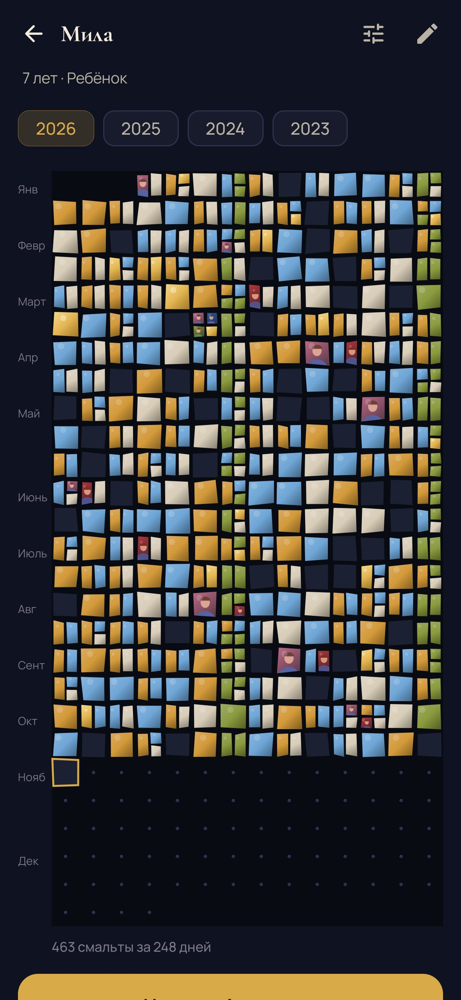
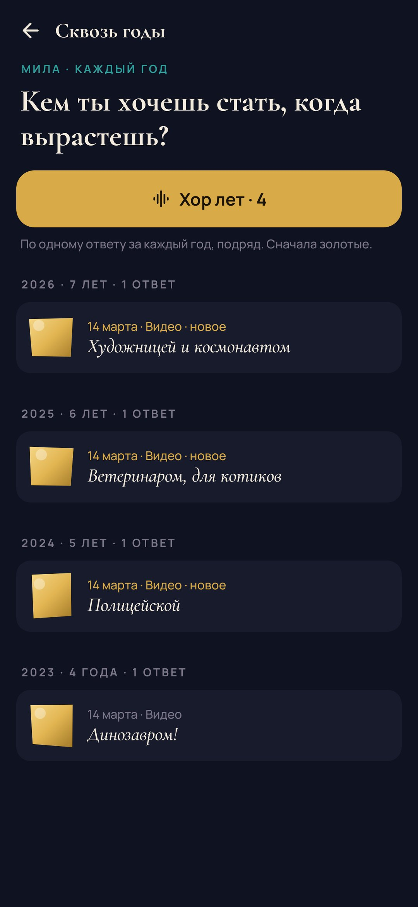
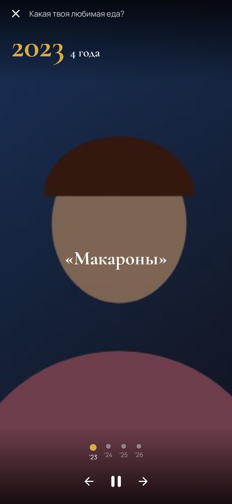
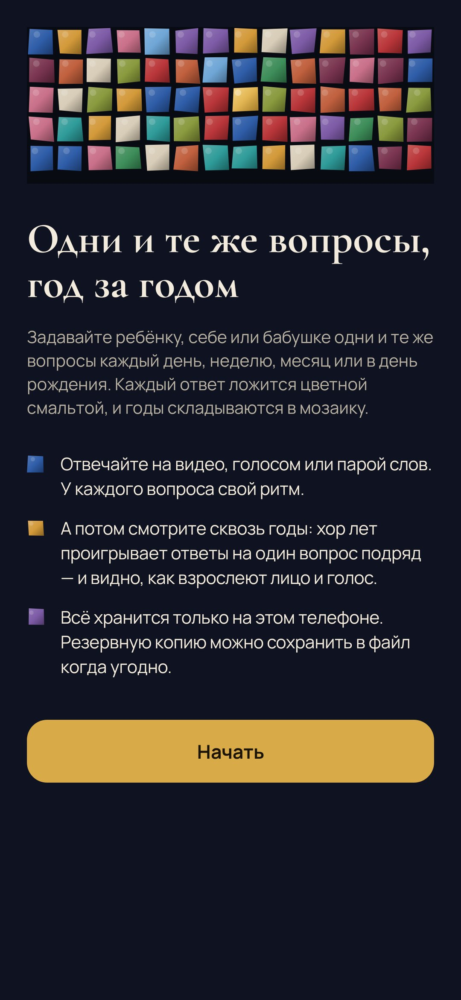
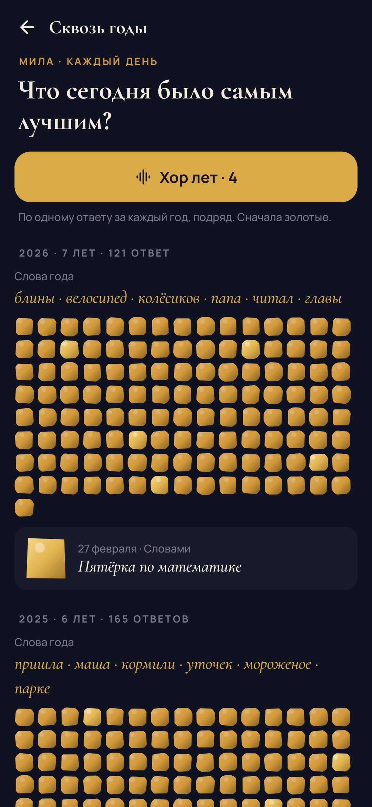
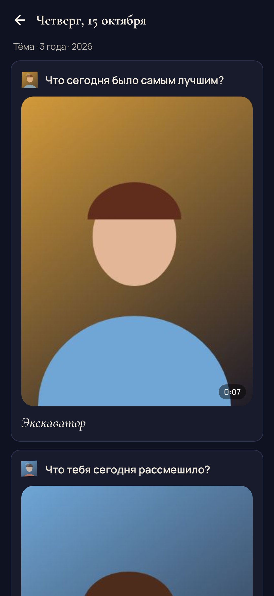
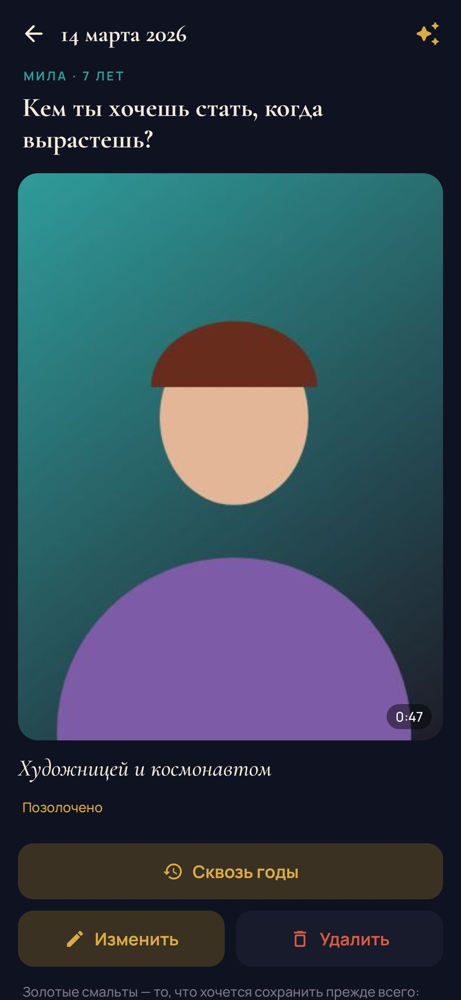
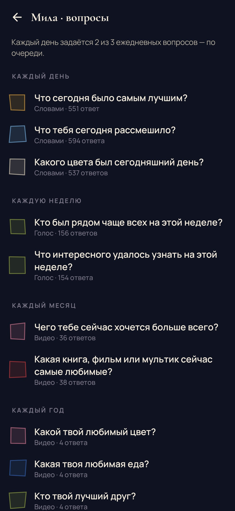

<div align="center">


# Смальта (Tessera)

### Одни и те же вопросы, год за годом.

*Задавайте ребёнку, себе или бабушке одни и те же вопросы каждый день, неделю, месяц или в день рождения — на видео, голосом или словами. Каждый ответ ложится цветной смальтой. Годы складываются в мозаику, по которой можно пройти назад, а хор лет показывает, как взрослеют лицо и голос. Бесплатно, без рекламы, без аккаунта и без облака.*

[](https://github.com/bigdevwhale/tessera/actions/workflows/android.yml)
[](https://github.com/bigdevwhale/tessera/releases/latest)


[](LICENSE)

[English](README.md) · **Русский** · [Изменения](CHANGELOG.md)

   

</div>

---

## Идея

В некоторых семьях есть традиция: в день рождения задавать ребёнку одни и те же десять вопросов и записывать ответы в тетрадку. *Кем хочешь стать? Кто твой лучший друг? Чего боишься?* Если перечитать их через десять лет, получается портрет взросления. Смальта делает то же на телефоне и так часто, как хочется. Маленький вопрос каждый вечер, побольше — раз в неделю или месяц, большое интервью — в день рождения. Каждый ответ становится смальтой, кусочком стекла, в мозаике этого человека.

## Как это устроено

1. **Добавьте человека.** Ребёнка, себя, бабушку или дедушку. Он получит стартовый набор вопросов по возрасту, и у каждого вопроса свой ритм: *каждый день*, *каждую неделю*, *каждый месяц* или *каждый год* (в день рождения).
2. **Отвечайте.** Каждый вечер появляются вопросы, до которых дошла очередь. Длинный список ежедневных вопросов идёт по очереди, по несколько в день, чтобы не превращаться в обязанность. Отвечать можно на видео, голосом или парой слов.
3. **Снимайте как следует.** Камера встроена в приложение, поэтому вопрос остаётся на экране, пока вы говорите. Поверх изображения полупрозрачно лежит кадр прошлого раза: так легко сесть так же, и годы выстраиваются ровно. Перед записью идёт отсчёт 3-2-1, а золотое кольцо показывает оставшееся время: 15 секунд для ежедневного вопроса, пять минут для дня рождения.
4. **Год назад…** Сразу после ответа возвращается прошлогодний ответ на тот же вопрос.

## Сквозь годы

| | |
|---|---|
| 🧩 **Панно** | Год каждого человека — мозаика из рядов по две недели, одна смальта на день, неровная, как колотая вручную. Видеоответ виден сквозь стекло своего вопроса; день с несколькими ответами раскалывается на мелкие смальты. |
| 🎼 **Хор лет** | По одному ответу за каждый год на один и тот же вопрос, подряд: *динозавром → полицейской → ветеринаром → художницей и космонавтом.* Видео на весь экран, голос звучит, слова остаются на экране, пока их не прочтёшь. |
| ✨ **Золотые смальты** | Отметьте ответы, которые хочется сохранить прежде всего. В панно они становятся сусальным золотом, и хор выбирает их первыми. |
| 🪨 **Неизменно с…** | Ответ, который держится три года и больше, отмечается: *бабушкины блины, неизменно с 2025.* |
| 🔤 **Слова года** | К чему год ежедневных ответов возвращался снова и снова: *купаться · кораблики · песок · экскаватор.* |
| 📅 **Этот день** | Что было сказано в эту дату в прошлые годы — вверху главного экрана. |
| 🎂 **Годовое интервью** | В день рождения вопросы года ждут одним сеансом, с прошлогодним кадром в камере. |

## Вопросы

В библиотеке больше пятидесяти вопросов на русском и английском, в пяти наборах. Можно добавить любой из них или написать свой, а для каждого вопроса выбрать, как часто его задавать и как на него обычно отвечать.

- **Малыши (3–6)**: всё на видео, ничего читать и печатать.
- **Дети** и **подростки**: друзья, страхи, кем стать, что меняется.
- **Взрослые**: что важно сейчас, чему научил год.
- **Старшие**: дом, где прошло детство, история любви, песня из молодости. Их голоса — пока есть время спросить.

Вопросы по-русски написаны без прошедшего времени с родом, поэтому одинаково звучат для всех.

## Приватность

Нет аккаунта, облака и аналитики. Видео, голос и слова хранятся в папке приложения на телефоне. *Настройки → Резервная копия* упаковывает всё, вместе с медиа, в один ZIP, который вы храните где хотите. Камера и микрофон работают только во время записи ответа. Единственное уведомление — одно вечернее напоминание, и только если ждёт вопрос.

## Скриншоты

     

## Сборка

```bash
./gradlew assembleDebug             # app.tessera.dev
./gradlew assembleDebug -Pdemo      # app.tessera.demo: Мила, Тёма и бабушка Вера с годами ответов
./gradlew testDebugUnitTest         # тесты
./gradlew testDebugUnitTest -Prender --tests '*RenderArtScreens*' && python tools/shots.py   # скриншоты для README
python tools/icon.py                # docs/logo.png из иконки приложения
```

Kotlin, Jetpack Compose, Room, DataStore, CameraX. Шрифты: Cormorant и Manrope (OFL).

Часть [Stillcraft](https://bigdevwhale.github.io/stillcraft/). Лицензия MIT.
